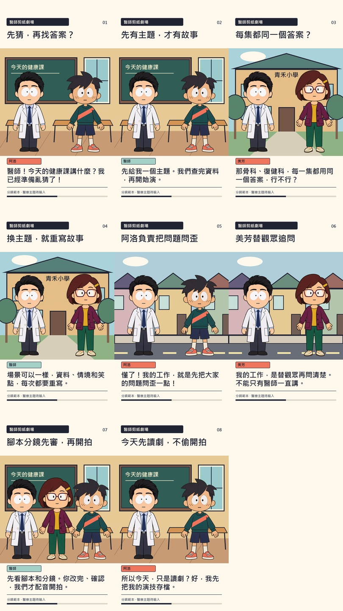

# 醫師剪紙短劇 Skill

把復健科、骨科主題做成 **30–60 秒的繁體中文校園互動短劇**。先交腳本與分鏡，等你修改、確認，才生成配音配樂及直式影片。



這是通用範本，尚未指定疾病主題。目前附的是**待審分鏡與讀劇腳本**，不含新生成的有聲示範片。

- [完整通用腳本](examples/draft/script.md)
- [分鏡總覽](examples/draft/storyboard.jpg)
- [分鏡網頁原始檔，下載整包後開啟](examples/draft/storyboard.html)
- [Skill 製作指示](SKILL.md)

## 風格與固定角色

採《南方四賤客》式的平面剪紙、硬切與冷面喜劇節奏，人物、服裝、台詞、學校與街道皆採原創設計，不重現原作角色或場景。

| 角色 | 外觀與功能 |
|---|---|
| 醫師 | 依使用者照片建立，黑髮、白袍、藍領帶，冷面拆解迷思 |
| 阿洛 | 原創學生，雀斑、青色斜紋上衣、短褲，負責直白提問 |
| 美芳 | 原創成年家長，短髮、方框眼鏡、紫紅外套、綠褲，替成人觀眾追問 |

場景：教室、虛構的青禾小學校園、一般街道。**所有角色在每張分鏡都使用相同尺寸、同一腳底基準；說話者切換時不放大或縮小人物。** 動畫以接話、嘴型、點頭、搖頭和停頓為主，至少 75% 分鏡為人物對話。

## 給 AI 的一句話

在可以讀檔並執行 Python 的代理環境中，讀取本專案後輸入：

```text
使用 $doctor-cutout-reels。
主題：＿＿＿＿
用醫師與原創配角，在教室、校園或街道互動對話。
規劃 30～60 秒，人物維持相同尺寸。
先給我完整腳本和分鏡，我修改確認之後，才生成影片。
```

不必每次填品牌問卷；可視需要補觀眾、醫師名稱與片尾行動。主題換了，資料、情境與笑點也要重寫。成年醫療問題優先由成年角色討論，不把成人建議套給學生。

在 Codex 可請內建 skill-installer 安裝：

```text
幫我安裝 https://github.com/patrioticman123-del/doctor-cutout-reels
根目錄的 doctor-cutout-reels skill。
```

或將整個專案資料夾放入自己的 skills 目錄，保留資產與 scripts/references/examples，再開啟新的工作階段確認可用。

## 先產生分鏡

Python 3.10+。Windows PowerShell：

```powershell
git clone https://github.com/patrioticman123-del/doctor-cutout-reels.git
cd doctor-cutout-reels
python -m venv .venv
.venv/Scripts/python.exe -m pip install -r requirements.txt
.venv/Scripts/python.exe scripts/render.py examples/template.json --out build/template
```

macOS/Linux 用 `python3 -m venv .venv`，其餘 Python 路徑改為 `.venv/bin/python`。macOS 自動找 PingFang，Linux 可裝 Noto Sans CJK；也可用 `--font` 指定中文字體。Windows 使用系統微軟正黑體。套件不散布系統字體。

開啟 `build/template/storyboard.html`，每幕都有完整對話、場景、動作、反應、來源與估計秒數；`script.md` 是文字腳本。**這一步不呼叫配音服務，也不生成音樂、音檔或影片。** 腳本由使用 skill 的 AI 依主題編寫，renderer 不會自行呼叫文字模型。

## 修改、確認後才開拍

你可回覆「第 3 幕台詞改成……」「全部改在教室」「最後多一個反應」等。AI 同步修改 JSON，重新交腳本與分鏡。只改 `script.md` 不會改變影片。

當你明確確認目前版本並要求生成影片後，AI 才可使用 `draft.json` 中的 revision：

```sh
python scripts/render.py episode.json --out build/my-episode --render --approved-hash CONFIRMED_REVISION --voice edge
```

必須先在**同一輸出目錄**建立草稿。程式會核對劇本、角色圖片及引擎的版本，修改後舊碼就失效。確認碼只防止誤用舊版，不能取代你的明確確認；skill 會在審稿階段停下。

配音後按真實音長排鏡頭。成品必須為 30–60 秒；超出就需修稿，不截斷人聲。若改動已確認台詞，會重新交稿。成品有 H.264/AAC MP4、SRT、預覽播放器、分鏡、來源與時間軸，並保留分離 WAV。

## 配音與動畫能力

- `--voice edge`：線上台灣華語，無需 API key；對話文字會送至線上 TTS。第三方 edge-tts 用戶端無 SLA，失敗可重跑並沿用成功快取。
- `--voice sapi`：Windows 已安裝的本機華語聲線，不需網路；優先 PowerShell 7，否則 Windows PowerShell。聲音名稱見 [格式說明](references/format.md)。Windows 預設此後端，其他系統預設 Edge。
- `--voice files`：接真人錄音或其他 TTS，每幕設定 `audio` 路徑。
- 原創程序配樂：撥弦、低音、輕打擊；對話時降低音量，笑點留白。不是影集音軌。

嘴型採音量開合，不是逐音素口型；字幕依音長按字長切段，不是逐字語音辨識。現成引擎支援固定尺寸人物、嘴型、點頭、搖頭、眨眼與三種場景；複雜走位、手部接觸、醫療動作示範需另行擴充並重新交分鏡，不能只寫在腳本中就宣稱已實作。合成配音不代表醫師本人聲音。

## 醫療來源、素材與驗證

醫療片必須附可靠來源，並將臨床說法對應到各幕。AI 負責查證；renderer 只能檢查格式和來源 ID，不能判定醫學真假。公開使用前由醫師審閱實際臨床內容。

原始照片未收錄，僅包含內建 imagegen 生成的角色。[生成提示詞](references/character-prompt.txt)、[配角提示詞](references/cast-prompts.txt) 和 `assets/cast.json` 定位一併提供。程式、文件與原創配角採 MIT；醫師肖像資產及其出現在分鏡中的使用權不包含在 MIT，其他使用者請換成自己有權使用的人物。

```sh
python scripts/render.py examples/template.json --check
python -m unittest discover -s tests -v
```

測試涵蓋來源、字幕、音訊快取、靜音拒絕、草稿不產生音訊、版本確認及用合成測試音檔產出的可解碼影片。測試音檔僅用於暫存測試，不作為配音展示。

工作流程受到 [Summer's Lab 的 card-reels-kit](https://github.com/Summerhuang585/card-reels-kit) 啟發；人物、舞台、聲音與 Python 引擎均為重新實作。
